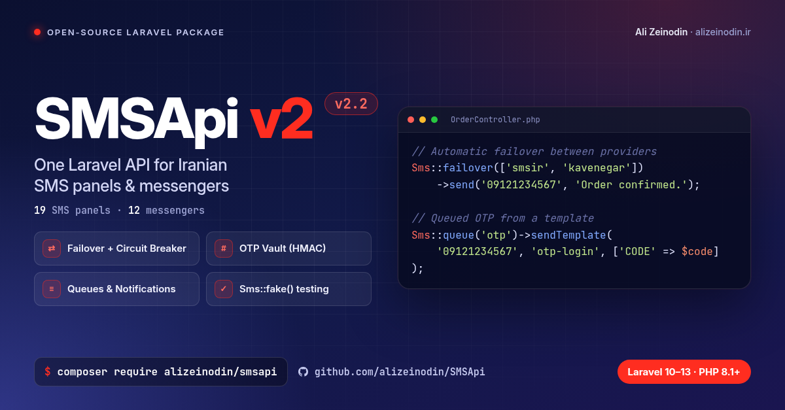

# SMSApi

[فارسی](README.fa.md)



[](https://github.com/alizeinodin/SMSApi/actions/workflows/tests.yml)
[](https://packagist.org/packages/alizeinodin/smsapi)
[](https://packagist.org/packages/alizeinodin/smsapi)
[](LICENSE)

Laravel package for Iranian SMS panels. Supports Laravel 10–13 on PHP 8.1+ (Laravel 13 requires PHP 8.3+). The banner graphic still says Laravel 10–12. One API covers **sms.ir**, **Kavenegar**, **Ghasedak**, **Melipayamak**, **Farazsms**, **Magfa**, **IPPanel**, **Niksms**, **Mediana**, **Avanak**, **LimoSMS**, **Amoot**, **Farapayamak**, **Payamito**, **Payamaknovin**, **Bahmanpayam**, **Payamresan**, **Behinpayam**, **Rastinsms**, and other Iranian panels.

It also sends through **Telegram**, **WhatsApp**, **Bale**, **Eitaa**, **Rubika**, **Gap**, and **iGap**.

Use it to ship OTP delivery, multi-panel failover, and the rest of the outbound flow without a one-off client per provider.

```bash
composer require alizeinodin/smsapi
```

---

## Install

```bash
composer require alizeinodin/smsapi
php artisan smsapi:install
```

`.env`:

```env
SMSAPI_DRIVER=smsir
SMSAPI_API_KEY=your-api-key
SMSAPI_LINE_NUMBER=30007
```

Local development without a real panel:

```env
SMSAPI_DRIVER=array
```

Optional features (logging, OTP vault, rate limiter, webhook) are off until you install them:

```bash
php artisan smsapi:install logging
php artisan smsapi:install otp
php artisan smsapi:install resilience
php artisan smsapi:install all
```

---

## Usage

```php
use Alizeinodin\SmsApi\Facades\Sms;

Sms::send('09121234567', 'Your order was placed.');
```

### Failover

```php
Sms::failover(['smsir', 'kavenegar'])->send('09121234567', 'Hello');
```

Or in `.env`:

```env
SMSAPI_DRIVER=failover
SMSAPI_FAILOVER_DRIVERS=smsir,kavenegar
```

A read timeout does not mean the provider rejected the message. The panel may already have accepted it, so failing over — or retrying the queue job — can send the same SMS twice. The default request timeout is 10 seconds and the connect timeout is 5 seconds. Keep the queue job timeout greater than `timeout × number of failover drivers`.

### Templates

Define the template in `config/smsapi.php`, then send it by logical name:

```php
Sms::template('otp-login')->to($user)->send(['CODE' => '12345']);

// Email instead of SMS, or both
Sms::otp('otp-login')->to($user)->mail()->send(['CODE' => '12345']);
Sms::otp('otp-login')->to($user)->both()->send(['CODE' => '12345']);
```

> `Sms::otp()` only **delivers**. You still generate the OTP code yourself.

### OTP vault — issue and check a code

```bash
php artisan smsapi:install otp
```

```php
Sms::challenge('login')->template('otp-login')->to($user)->send();

Sms::challenge('login')->check($user, $request->input('code'));
```

The code is stored as an HMAC (not plaintext), with an expiry and an attempt limit.

### Queues

```php
Sms::queue('otp')->sendTemplate('09121234567', 'otp-login', ['CODE' => '12345']);

Sms::template('otp-login')->to($user)->queue('otp')->send(['CODE' => '12345']);
Sms::template('otp-login')->to($user)->sync()->send(['CODE' => '12345']);
```

### Laravel notifications

```php
use Alizeinodin\SmsApi\Notifications\NotificationMessage;

public function via($notifiable): array
{
    return ['sms'];
}

public function toSms($notifiable): NotificationMessage
{
    return NotificationMessage::create()
        ->template('otp-login', ['CODE' => $this->code]);
}
```

### Tests

```php
Sms::fake();

Sms::send('09121234567', 'test');

Sms::assertSentTo('09121234567');
Sms::assertNothingSent();
```

---

## Supported drivers

The config key is what you set as `SMSAPI_DRIVER` or pass to `Sms::driver('…')`.

### SMS (Iran)

| Config | Provider |
|--------|----------|
| `smsir` | sms.ir |
| `kavenegar` | Kavenegar |
| `ghasedak` | Ghasedak |
| `melipayamak` | Melipayamak |
| `farazsms` | Farazsms |
| `magfa` | Magfa |
| `ippanel` | IPPanel |
| `niksms` | Niksms |
| `mediana` | Mediana |
| `limosms` | LimoSMS |
| `avanak` | Avanak (voice) |
| `amoot` | Amoot |
| `farapayamak` | Farapayamak |
| `payamito` | Payamito |
| `payamaknovin` | Payamaknovin |
| `bahmanpayam` | Bahmanpayam |
| `payamresan` | Payamresan |
| `behinpayam` | Behinpayam |
| `rastinsms` | Rastinsms |

### Messengers

| Config | Service |
|--------|---------|
| `telegram` | Telegram |
| `whatsapp` | WhatsApp |
| `bale` | Bale |
| `eitaa` | Eitaa |
| `rubika` | Rubika |
| `gap` | Gap |
| `igap` | iGap |
| `messenger` | Facebook Messenger |
| `viber` | Viber |
| `line` | LINE |
| `discord` | Discord |
| `slack` | Slack |

### Local

| Config | Use |
|--------|-----|
| `array` | In-memory driver for tests and local work |
| `log` | Writes to the Laravel log |
| `failover` | Tries several drivers and moves on when one fails |

Per-driver settings live in `config/smsapi.php` and the wiki.

---

## What it covers

| Need | Supported |
|------|-----------|
| Simple and bulk send | Yes |
| A template id per panel | Yes |
| Failover when a panel errors | Yes |
| Several accounts or lines on one panel | Yes |
| Queues and retries | Yes |
| OTP by email | Yes |
| Issue and check OTP (vault) | Optional |
| Laravel notification channel | Yes |
| Iranian number normalization | Yes |
| Send logs | Optional |
| Delivery status (webhook) | Optional |
| Rate limiter and circuit breaker | Optional |
| HTTP API for sending | Optional |
| Messengers | Yes |
| `Sms::fake()` in tests | Yes |

---

## Common settings

```env
SMSAPI_DRIVER=smsir
SMSAPI_API_KEY=
SMSAPI_LINE_NUMBER=

SMSAPI_FAILOVER_DRIVERS=smsir,kavenegar
SMSAPI_TIMEOUT=10
SMSAPI_CONNECT_TIMEOUT=5

SMSAPI_PHONE_FORMAT=local          # local | e164 | digits
SMSAPI_OTP_CHANNEL=sms             # sms | mail | both

SMSAPI_OTP_VAULT_ENABLED=false
SMSAPI_LOGGING_ENABLED=false
```

---

## HTTP API and webhooks

Both are off until you install them. After that, send the token in a header (`X-SMSAPI-Token` or `X-SMSAPI-Webhook-Token`, or `Authorization: Bearer`). `?token=` is ignored unless `SMSAPI_API_ALLOW_QUERY_TOKEN` / `SMSAPI_WEBHOOK_ALLOW_QUERY_TOKEN=true`. A webhook with no token is closed (`SMSAPI_WEBHOOK_REQUIRE_TOKEN` defaults to true). The send route is throttled at 60 requests per minute unless `SMSAPI_API_THROTTLE` is empty.

Provider API keys and bot tokens are removed from HTTP exception text before it is stored in `sms_logs`. The send API returns a generic error and does not echo exception text.

---

Static analysis: `vendor/bin/phpstan analyse` (Larastan, level 5, with `phpstan-baseline.neon`).

## Docs

Full English notes are also on the GitHub wiki:

**https://github.com/alizeinodin/SMSApi/wiki**

- [Home](https://github.com/alizeinodin/SMSApi/wiki)
- [Installation](https://github.com/alizeinodin/SMSApi/wiki/installation)
- [Configuration](https://github.com/alizeinodin/SMSApi/wiki/configuration)
- [Sending messages](https://github.com/alizeinodin/SMSApi/wiki/sending)
- [Templates](https://github.com/alizeinodin/SMSApi/wiki/templates)
- [OTP vault](https://github.com/alizeinodin/SMSApi/wiki/otp-vault)
- [Queues & failover](https://github.com/alizeinodin/SMSApi/wiki/queues-failover)
- [Notifications](https://github.com/alizeinodin/SMSApi/wiki/notifications)
- [HTTP API & webhooks](https://github.com/alizeinodin/SMSApi/wiki/http-api)
- [Drivers](https://github.com/alizeinodin/SMSApi/wiki/drivers)
- [Adding a driver](https://github.com/alizeinodin/SMSApi/wiki/adding-a-driver)
- [Testing](https://github.com/alizeinodin/SMSApi/wiki/testing)
- [Security](https://github.com/alizeinodin/SMSApi/wiki/security)

---

## Changes and license

- Release notes: [CHANGELOG.md](CHANGELOG.md)
- License: [MIT](LICENSE)
